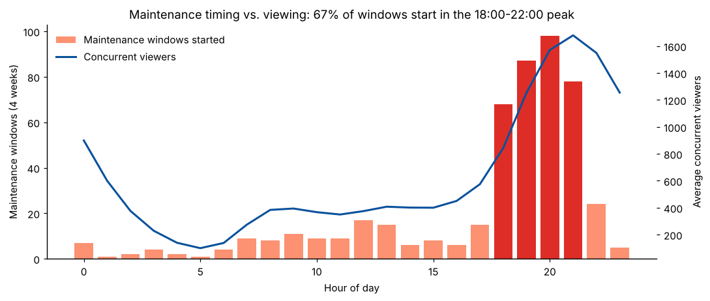
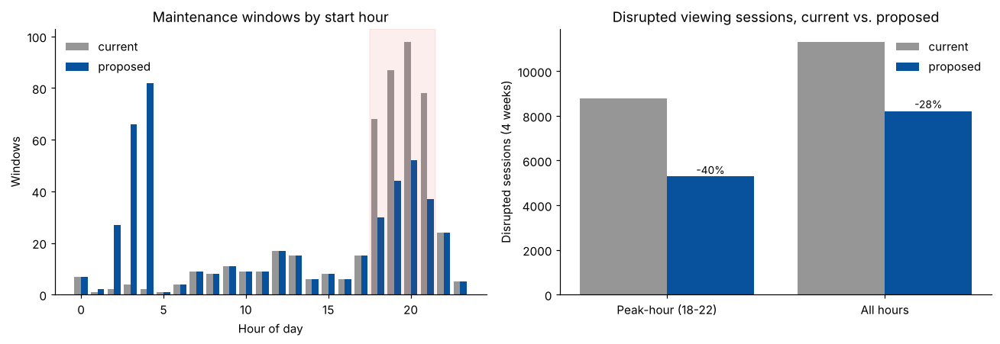
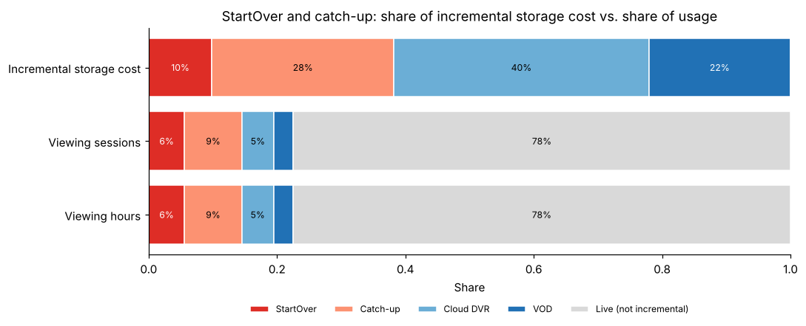

# TV Session Analytics: Sessionization, Maintenance Timing and Storage Cost

This project turns raw IPTV set-top box telemetry into an analysis-ready session data model, then
uses it for two analyses. The first asks when channel maintenance disrupts viewers and how much an
off-peak schedule would help. The second asks which playback features drive storage cost. A PySpark
job and Snowflake SQL handle production scale. Pandas notebooks run the same logic on a synthetic
sample.

## Business goal

An IPTV operator's raw set-top box (STB) feed holds 1.5B+ event records. Analysts had no reliable
"viewing session" table to work from. Two operational questions were open:

1. **Maintenance timing.** Encoder firmware updates, configuration pushes, EPG refreshes and
   incidents interrupt everyone tuned to the affected channel. When does this happen, how many
   viewers does it reach, and how much disruption would moving deferrable work overnight avoid?
2. **Storage cost.** StartOver, catch-up, cloud DVR and VOD each keep content archives. Which
   features drive the incremental storage bill, and is that spend proportional to how much the
   features are used?

This project is modelled on work I did for a telecom/IPTV client. There, the restructured dataset
fed automated dashboards. The maintenance analysis found 68% of maintenance in the 6-10 PM peak,
affecting 22% of active users, and led to a schedule change that cut peak-hour disruption by 40%.
The storage analysis found StartOver and catch-up drove 38% of incremental storage cost from 14% of
sessions. The numbers below are what this code produces on synthetic data.

## Data

`src/generate_data.py` writes the raw tables to `data/raw/`. It simulates 4 weeks (2025-03-03 to
2025-03-30) for a sample of 10,000 boxes and 126 channels, with a fixed seed.

| Table | Rows | Description |
|---|---|---|
| `stb_events.csv.gz` | 1,555,814 | Raw telemetry: device_id, event_time, event_type (TUNE / STANDBY), channel_id, playback_mode (LIVE, STARTOVER, CATCHUP, CLOUD_DVR, VOD), content_age_min |
| `channels.csv` | 126 | Lineup: genre, HD flag, StartOver enabled, catch-up window (0 / 3 / 7 days) |
| `devices.csv` | 10,000 | Box attributes: region, box model, package, activation date |
| `maintenance_events.csv` | 494 | Channel maintenance windows: start, duration, type, planned flag, deferrable flag |
| `storage_usage_daily.csv` | 12,936 | GB stored per day x channel x feature, with storage tier |
| `storage_rate_card.csv` | 2 | USD per GB-month for the hot and standard tiers (illustrative prices) |

How the generator works:

- **Viewing.** Each box-day has a chance of being active. Viewing sittings start at times drawn from
  a prime-time-heavy daily curve. Each sitting is a chain of tunes, about 22% of them short zaps.
  Channels are picked by popularity, and the playback mode depends on which features the channel
  supports.
- **Planted data-quality issues.** 0.4% of rows are duplicates, 0.15% have device clocks reset to
  2015, rows arrive out of order, and 3% of sittings never send STANDBY.
- **Maintenance.** The ops push queue is released at the end of the business day, so planned work
  clusters in the evening. Unplanned incidents scale with load.
- **Storage.** GB stored is bitrate ladder x retention hours for StartOver (24 h, hot) and catch-up
  (3 or 7 days). Cloud DVR scales with channel popularity, and VOD is a shared library.

**Scale.** The production feed behind this design held 1.5B+ session records. This sample has
1.2M sessions, so every file stays under 20 MB. `python src/generate_data.py --devices 40000`
produces a sample about 4x larger.

## Approach

1. **Sessionization and data model** (`01_sessionization_data_model.ipynb`).
   - Profile the raw feed, then drop duplicate events and events outside the extraction window.
   - Sort each device's events. A session starts at each TUNE and ends at the device's next event.
     The end is capped at a 240-minute inactivity timeout, and sessions under 30 seconds are
     flagged as zaps.
   - Validate the result: one session per TUNE, no negative durations, no overlaps.
   - Build `fact_session` plus `dim_channel` and `dim_device`. Build the dashboard aggregates
     `agg_hourly_channel_viewing` (sessions split across clock hours) and `agg_daily_kpis`.
   - The same rules exist three times: `src/sessionize.py` (pandas, executed here),
     `src/spark_sessionize.py` (PySpark, production) and `sql/02_fact_session.sql` (Snowflake).
2. **Maintenance timing** (`02_maintenance_timing.ipynb`).
   - Interval-join each maintenance window to the sessions it overlaps on that channel. Only
     non-zap live and StartOver sessions count, because the other modes are served from storage.
   - Measure reach (weekly share of active devices affected), disrupted sessions and disrupted
     viewer-minutes, split into peak (18:00-22:00) and off-peak.
   - Simulate a policy that moves deferrable peak work to each channel's lowest-viewing hour between
     01:00 and 05:00, with a crew capacity of 3 windows per hour. Replay the observed sessions
     against the new schedule, then test sensitivity to capacity and to which work is movable.
3. **Storage cost attribution** (`03_storage_cost_attribution.ipynb`).
   - Cost = GB x tier price, split by feature. "Incremental" cost means everything beyond the live
     delivery buffer.
   - Compare each feature's share of incremental cost with its share of sessions and viewing hours.
   - Check how concentrated time-shift usage is across channels, and how old the content is when it
     is watched.
   - Price three retention scenarios: StartOver 24 h to 4 h, and catch-up 7 to 3 days on either
     low-use channels or all 7-day channels.

Production SQL lives in `sql/`:

- `01_raw_tables.sql`: stage, file format, raw tables and `COPY INTO`
- `02_fact_session.sql`: sessionization with `LEAD()` and an incremental `MERGE`, plus
  data-quality assertions
- `03_marts.sql`: hourly viewing mart, maintenance impact table, weekly reach view, and storage
  attribution view

## Results

| Metric | Value |
|---|---|
| Raw events -> clean events -> sessions | 1,555,814 -> 1,547,298 -> **1,198,334** |
| Maintenance windows starting 18:00-22:00 | **67.0%** (494 windows on 123 channels) |
| Avg weekly share of active devices hit by maintenance | **23.1%** |
| Peak-hour disrupted sessions, current vs. proposed schedule | 8,778 -> 5,299 (**-39.6%**) |
| All disrupted sessions, current vs. proposed | 11,326 -> 8,187 (-27.7%) |
| Weekly share of active devices affected after the change | 23.1% -> 17.6% |
| StartOver + catch-up share of incremental storage cost | **38.2%** |
| StartOver + catch-up share of viewing sessions | **14.5%** |
| Savings from StartOver 4 h buffer + catch-up 3 days on low-use channels | 15.7% of incremental storage, 0.04% of viewing at risk |

Main findings:

- **Maintenance lands at peak.** A peak window hits 25.8 devices on average, against 14.9 off-peak.
  Peak windows cause 77.5% of all disrupted sessions.
- **The schedule change.** Only the 168 deferrable peak windows move. Unplanned incidents and
  non-deferrable work stay where they are.
- **Crew capacity matters.** With 1 window per hour, the peak-hour cut is 20.5%. If all planned
  work could move, it would be 53.8%.
- **Storage spend tracks the archive, not usage.** StartOver and catch-up cost 2.6x their share of
  usage. The half of channels with the least time-shift viewing carries 46.3% of the StartOver and
  catch-up storage cost but only 7.0% of those sessions.
- **Old catch-up content is rarely watched.** On 7-day channels, 94.2% of catch-up viewing happens
  within 3 days of broadcast.







## Repository structure

```
tv-session-analytics/
  README.md
  requirements.txt
  data/
    raw/                         synthetic telemetry and reference tables (generated)
    processed/                   aggregates and analysis outputs (fact_session.csv.gz is
                                 regenerated by notebook 01 and not committed)
  src/
    generate_data.py             deterministic synthetic data generator
    sessionize.py                pandas sessionization (executed by the notebooks)
    spark_sessionize.py          PySpark production job (same rules, not executed here)
  sql/
    01_raw_tables.sql            Snowflake stage, raw tables, COPY INTO
    02_fact_session.sql          Snowflake sessionization model (MERGE) + DQ checks
    03_marts.sql                 hourly viewing, maintenance impact, reach, storage attribution
  notebooks/
    01_sessionization_data_model.ipynb
    02_maintenance_timing.ipynb
    03_storage_cost_attribution.ipynb
  reports/figures/               charts saved by the notebooks
```

## How to reproduce

```bash
pip install -r requirements.txt
python src/generate_data.py
cd notebooks
jupyter nbconvert --to notebook --execute --inplace 01_sessionization_data_model.ipynb
jupyter nbconvert --to notebook --execute --inplace 02_maintenance_timing.ipynb
jupyter nbconvert --to notebook --execute --inplace 03_storage_cost_attribution.ipynb
```

Notebook 01 writes `data/processed/fact_session.csv.gz`, which notebooks 02 and 03 read. If that
file is missing, they rebuild it from the raw events. Each notebook runs in under a minute.

To run the production job on a Spark 3.x cluster, see the usage block at the top of
`src/spark_sessionize.py`. PySpark and the Snowflake connector are not part of
`requirements.txt`.

## Tech stack

Python 3, pandas, NumPy, Matplotlib, Jupyter (executed pipeline). PySpark with window functions,
and Snowflake SQL with `LEAD`, `MERGE`, `GENERATOR`, interval joins and views (production
pipeline, included as code).

## Note on data

All data in this repository is synthetic, generated by `src/generate_data.py`. The operator,
channels and devices are fictional. No client data is included. The generator plants plausible
behaviour (a prime-time viewing peak, maintenance clustered at the end of the business day, rolling
time-shift archives) so the pipeline and analyses can be shown end to end. The results describe
this synthetic sample and are not measurements from a real network. Storage prices are illustrative.
